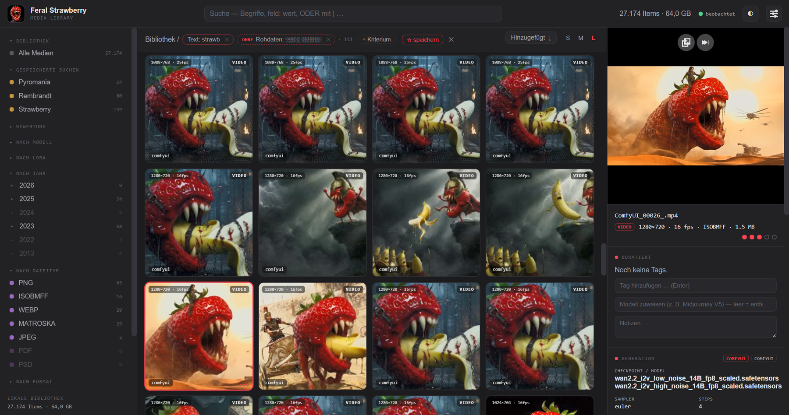

# 🍓 Feral Media Library

> 🇬🇧 **English version:** [`README.md`](README.md) · English docs:
> [`docs/en/`](docs/en/)

Die **Feral Media Library** — kurz **fml** — ist eine lokale
Medienverwaltung für **KI-generierte Bilder und Videos**, auf Wunsch auch
für **Musik** (optionales Audio-Modul). Sie ist für Bestände gebaut, an
denen klassische Foto-Tools scheitern: animierte WEBPs, WEBM-Videos und zehntausende Dateien
mit eingebetteten ComfyUI-/A1111-Workflows, Prompts und Seeds. Alles läuft
auf deinem Rechner: kein Cloud-Dienst, kein Konto, der Server ist nur unter
`127.0.0.1` erreichbar.



> **Status: Beta.** Läuft stabil im Alltagstest mit Beständen im
> sechsstelligen Bereich und ist auf 250.000+ Medien ausgelegt. Es ist ein
> Hobby-Projekt in aktiver Entwicklung - mach Backups (siehe „Gut zu
> wissen").

## Neu in 2026.10.2

Medien gehen jetzt auch hinaus, und die Originale bleiben, wo sie sind:

- **Kopien exportieren:** Auswahl oder Suchergebnis per Sammel-Aktion als
  geprüfte Kopie in einen Export-Ordner legen, für den Videoschnitt, eine
  CD oder jemand anderen. Geht auch im Übersichtsmodus.
- **Angaben reisen mit:** Musik-Angaben, Songtext und Cover von Hand
  landen auf Wunsch in der Kopie von MP3 und M4A; ein anderes fml zeigt
  das Cover dann auch an.
- **Ausschnitt:** ein Stück aus einem Song oder Video markieren, in
  Schleife anhören und als WAV oder MP4 schreiben (Modul, ab Werk aus).
- **Songtext von Hand:** Text korrigieren oder eintragen und die Zeiten
  per Tastendruck mitklopfen.
- **Musiksammlung nach Ordnern:** die Audioliste gruppiert nach Ordnern,
  zeigt Dubletten mit allen Fundorten, dazu das Suchwort `ordner:`.

## Neu in 2026.10.1

Das Audio-Modul ist damit vollständig:

- **Musik-Angaben von Hand:** Titel, Interpret, Album, Nummer, Jahr und
  Genre direkt im Panel setzen, auch für mehrere ausgewählte Songs auf
  einmal. Die Dateien bleiben unverändert; Liste, Seitenleiste und Suche
  sehen den gesetzten Wert.
- **Angaben austauschen:** Was einmal nachgepflegt ist, reist zusammen mit
  den Zeitkommentaren als Datei in ein anderes fml. Abweichende eigene
  Angaben bleiben dort stehen, außer man lässt die Datei gewinnen.
- **Audioliste zum Verwalten:** Der Regler **☰ S M L** schaltet zwischen
  Zeilen mit Wellenform und flachen Zeilen mit Titel, Interpret, Album,
  Nummer, Jahr und Genre.

Alles im Einzelnen: [`CHANGELOG.de.md`](CHANGELOG.de.md).

## Drei Ziele, drei Modi

Jede Aufnahme in fml ist ein Ordner plus ein **Modus**. Der Modus legt
allein fest, was mit der **Quelle** passiert, und damit, welches der drei
Ziele du erreichst:

| Ziel | Modus | Was mit der Quelle passiert | Braucht |
| --- | --- | --- | --- |
| **1. Übersicht** | **katalogisieren** | nichts: die Medien werden dort aufgenommen, wo sie liegen | nichts |
| **2. Sammeln** | **kopieren** | bleibt unangetastet; die Kopie liegt in der Media Library | Library-Verwaltung |
| **3. Konsolidieren** | **verschieben** | verifiziert Importiertes wird aus ihr gelöscht; nur Zweifelsfälle bleiben sichtbar liegen | Library-Verwaltung, Sicherheitsabfrage |

Jeden Modus gibt es in zwei **Häufigkeiten**: **einmal jetzt** (der Ordner
wird einmal verarbeitet) oder **dauerhaft beobachten** (der Ordner wird
zum Watchordner: was ComfyUI & Co. dort ablegen, wird von selbst
aufgenommen, sobald die Datei fertig geschrieben ist). Bit-identische
Dubletten erkennt jeder Weg am Inhalt.

### Ziel 1: Übersicht. Ansehen und ordnen, ohne anzufassen

Für den Fall: „Meine Medien liegen verstreut (oder bereits fertig sortiert)
auf der Platte, und ich will **Überblick, Suche und Kuratierung** - aber
niemand außer mir soll je eine Datei bewegen."

- **Hände-weg-Garantie:** Im Übersichtsmodus (Auslieferungszustand)
  **kopiert, verschiebt und löscht fml keine einzige Datei** an ihrem
  Ort oder in eine Library. Einzige Schreibstelle ist ein Export-Ordner,
  den du selbst einrichtest, für Kopien und Ausschnitte. Die
  Garantie ist serverseitig durchgesetzt - die entsprechenden Funktionen
  sind nicht versteckt, sondern gesperrt und erklären das auch so. Ein
  Badge „👁 Übersichtsmodus" in der Kopfzeile zeigt den Zustand.
- **Was geht:** Ordner oder ganze Laufwerke **katalogisieren** (einmal
  oder dauerhaft als Watchordner), suchen, filtern, bewerten, taggen,
  Notizen schreiben, **ablehnen** (nimmt ein Medium nur aus dem Katalog -
  die Datei bleibt liegen) und per 📂-Knopf zur Datei in den
  Explorer/Finder springen.
- **Was bewusst nicht geht:** in die Library kopieren, verschieben und
  das Rausverschieben Abgelehnter - alles, was Dateien bewegt oder in
  der Library anlegt.

Du kannst fml in diesem Modus gefahrlos auf einen fremden oder gewachsenen
Bestand loslassen, um ihn erst einmal zu **verstehen**.

### Ziel 2: Sammeln. Eine Library aufbauen, die Quellen bleiben

Für den Fall: „Ich will einen geordneten, dublettenfreien Bestand - aber
meine Sicherungen und Tool-Ordner sollen unangetastet bleiben, bis ich dem
Ergebnis traue."

- **kopieren** legt jede neue Datei in der **Media Library** ab
  (datumsbasierte Struktur `JJJJ/MM/TT/`), verifiziert die Kopie per
  SHA-256 gegen die Quelle und legt **bit-identische Dubletten nicht
  erneut ab**. Die Quelle wird nie angefasst; der Import ist rein lesend.
- Der Dauerbetrieb: ein **Watchordner** im Modus kopieren auf dem
  Output-Ordner von ComfyUI, A1111 & Co. Was dort entsteht, landet von
  selbst in der Library, die Originale bleiben am Ort.
- **Endzustand:** die Library ist vollständig und dublettenfrei, die
  Quellen sind nachweislich obsolet - liegen aber noch da. Wer sie
  loswerden will, geht zu Ziel 3.

### Ziel 3: Konsolidieren. Ein Bestand, sonst nirgends Kopien

Für den Fall: „Meine Medien liegen als Wildwuchs in alten Sicherungen,
Download- und Output-Ordnern - vieles doppelt und dreifach. Am Ende will
ich **einen einzigen Bestand**, und die alten Ordner sollen leer sein."

- **verschieben** ist kopieren plus Aufräumen: dieselbe Kopie in die
  Library, dieselbe Verifikation - und danach wird die Datei aus der
  Quelle **gelöscht**. Gelöscht wird ausschließlich, was nachweislich
  bit-identisch in der Library liegt und dessen Katalogeintrag
  gespeichert ist. Der Modus verlangt eine ausdrückliche Bestätigung.
- **Was in der Quelle übrig bleibt, ist Nachschau,** nie Verlust:
  `_dubletten/` (Inhalt war schon im Bestand, die Bestandskopie wurde
  frisch geprüft), `_fehler/`, `_unbekanntes-format/`, `_gesperrt/`
  (in fml abgelehnt) und `_ausgefiltert/` (Import-Regeln). Die Namen
  sind feste Bezeichner und bleiben in jeder Sprache gleich. Diese Ordner
  schaust du an und löschst sie selbst - fml räumt nie hinter dir auf.
- **Praxis:** Sicherung für Sicherung mit „verschieben" aufnehmen, oder
  einen Watchordner im Modus verschieben anlegen und die Altordner der
  Reihe nach hineinkippen; „leere Ordner löschen" räumt leer gewordene
  Unterordner mit ab. Dubletten erkennt der Import am Inhalt, egal aus
  welcher Sicherung sie kommen.
- **Aufräumen ohne Löschtaste:** „Löschen" gibt es in fml nicht.
  **Ablehnen** nimmt ein Medium aus dem Katalog und setzt seinen Hash auf
  die Sperrliste (kommt bei keinem Import wieder herein) - die Datei
  bleibt liegen. Wer abgelehnte Dateien auch physisch aus der Library
  haben will, nutzt den einen dafür vorgesehenen Weg: **„Abgelehnte
  rausverschieben"** (Admin → Wartung) verschiebt sie hash-verifiziert in
  einen Zielordner außerhalb der Library. Endgültig entsorgen ist dann
  bewusst Sache des Dateimanagers, nicht von fml.
- **Endzustand:** jeder Inhalt liegt genau einmal in der Library,
  datumssortiert, vollständig katalogisiert; die Quellordner sind leer
  bis auf das, was du bewusst nachschauen wolltest. Details zu Ablauf und
  Ausgangs-Ordnern: [`docs/import.md`](docs/import.md).

### Der Schalter: Library-Verwaltung

Ziel 1 geht ab Werk. Ziele 2 und 3 brauchen den Haken
**Library-Verwaltung** (Admin → Konfiguration), der ab Werk **aus** ist -
ohne ihn sind kopieren, verschieben und Rausverschieben serverseitig
gesperrt. Das ist der ganze Unterschied: ob fml deine Dateien anfassen
darf. Oberfläche, Suche und Kuratieren sind für alle drei Ziele dieselben,
und sie lassen sich **kombinieren**: eine Library verwalten und zusätzlich
externe Orte nur katalogisieren - die Sidebar-Facette „Fundort" (in der
Library / nur extern) hält beides auseinander, samt getrennter
Größenangaben.

## Was fml kann - und wie es genau funktioniert

- **Identität über Inhalt:** Jedes Medium wird über seinen SHA-256-Hash
  identifiziert, nicht über den Dateipfad. Dieselbe Datei an drei Orten
  ist **ein** Item mit drei Fundorten (eine Dubletten-Ansicht listet
  genau diese Fälle). Bewertungen und Tags hängen am Inhalt und überleben
  Umbenennungen.
- **Metadaten in zwei Schichten:** Schicht 1 liest die eingebetteten
  Roh-Metadaten verlustfrei aus PNG, JPEG, WEBP, GIF, BMP, TIFF, PSD,
  Kodak Photo CD und Video-Containern (WEBM/MP4/MOV - auch Videos tragen ComfyUI-Workflows).
  Schicht 2 interpretiert daraus durchsuchbare Felder: Prompt, Negativ,
  Modell, LoRAs, Seed, Sampler, Steps, Eingangsbild u. a., mit Parsern
  für ComfyUI, A1111/Forge, XMP (Midjourney, Lightroom-Bewertungen),
  Content Credentials (Gemini, ChatGPT, Firefly), Topaz, Video-Codecs und
  Musik (Tags, Suno).
  Weil die Rohdaten gespeichert bleiben, wirken Parser-Verbesserungen
  **rückwirkend** auf den ganzen Bestand - ohne die Dateien neu zu lesen.
- **Workflow-Ansicht:** der eingebettete ComfyUI-Workflow lässt sich als
  Node-Graph ansehen und als unverändertes `.json` herunterladen - per
  Drag&Drop direkt zurück in ComfyUI.
- **Suche als ein Zustand aus Chips:** Sidebar-Klicks (Medienart,
  Generator, Modell, LoRA, Jahr, Dateityp, Format, Auflösung, Bewertung,
  Eingangsbild, Fundort), getippte Begriffe und Grammatik-Ausdrücke landen
  als Chips in **einem** kombinierbaren Suchzustand; Cmd/Strg-Klick auf
  einen zweiten Wert derselben Gruppe heißt ODER, die Zähler links rechnen
  im aktiven Filter live mit. Tags und alles Weitere gibt es über
  „+ Kriterium" und die Tipphilfe im Suchfeld. Volltext
  über Prompts, Tags, Notizen und Dateinamen antwortet auch bei 250.000
  Medien in Millisekunden. Für präzise Fälle gibt es die Grammatik
  (`model: flux | krea -tag: wip rating>=4 sort: created-ab`), und jeder
  Suchzustand lässt sich per ☆ als **gespeicherte Suche** ablegen (lädt
  als bearbeitbare Chips zurück, mit Live-Zähler in der Sidebar).
- **Seed-Varianten auf einen Klick:** Der Knopf **„🎲 Seed-Varianten
  suchen"** im Metadaten-Panel baut aus einem Bild die exakte Suche nach
  seiner Generierung - gleicher Prompt, gleiches Modell, gleiche LoRAs,
  Sampler, Steps, CFG und Größe, nur der Seed variiert. Ideal, um eine
  Seed-Serie nebeneinanderzulegen, die beste Variante zu behalten und
  den Rest abzulehnen. Jedes Kriterium liegt dabei als normaler Chip in
  der Suche und lässt sich einzeln entfernen, wenn es lockerer sein soll.
- **Galerie für große Bestände:** virtualisiertes Grid (drei Dichten),
  Vollbild-**Lupe** zum schnellen Durchblättern (←/→ mit Vorladen, Tasten
  1-5 bewerten), **Einzelbildansicht** mit echtem Zoom
  (Anpassen/max. 100 %/50/100/200 %, Mausrad, Navigator) und breiter
  Metadaten-Spalte. Videos und animierte WEBPs spielen ab. Das
  Metadaten-Panel rechts lässt sich abschnittsweise einklappen oder mit
  **P** ganz wegklappen, wenn die Galerie die Breite braucht.
- **Kuratieren, auch in großen Schritten:** Bewertung, Tags, Notizen,
  manuelle Modell-Zuordnung und ein **Datum von Hand** (für eingescannte
  Fotos oder frisch gerippte alte CDs) - einzeln, per Multiselect (Shift/Strg) oder
  mit **„⚡ Sammel-Aktion" auf das komplette Suchergebnis** (ist etwas
  ausgewählt, ist im Dialog „Auswahl" vorgewählt). Die Sammel-Aktionen
  gehen behutsam vor: die Basisbewertung füllt nur Unbewertete, Tags
  werden hinzugefügt, Notizen angehängt; nur Modell und Datum ersetzen
  einen vorhandenen manuellen Wert. Manuelles
  ist eine **eigene Datenschicht**, strikt getrennt von dem, was aus den
  Dateien extrahiert wurde - nichts überschreibt einander. Unter macOS
  kommen die farbigen **Finder-Tags** als Tags mit; fml liest sie nur und
  schreibt nie in den Finder zurück.
- **Ablehnen statt löschen:** Entf (oder die Sammel-Aktion) entfernt
  Items aus dem Katalog und sperrt ihren Hash - **die Datei wird dabei
  nie angefasst**, egal in welchem Modus. Rückgängig: Eintrag aus der
  Sperrliste entfernen (Admin) und neu aufnehmen - die extrahierten
  Metadaten kommen vollständig wieder, eigene Bewertungen/Tags des
  abgelehnten Items sind dann allerdings weg.
- **Audio-Modul (optional, ab Werk aus):** Musik von Suno, aus
  ComfyUI (YuE, ACE-Step, MiniMax) oder eigene Aufnahmen: MP3, FLAC, Ogg,
  WAV, AIFF, CAF, M4A, mit allen eingebetteten Tags, Songtext in der
  Volltextsuche und Suno-Version aus den Content Credentials. Auch die
  gewöhnliche **Musiksammlung** ist zu Hause: Interpret, Album und Genre
  aus den Tags, als Gruppen in der Seitenleiste und als Sortierung, die
  ein Album in seiner Reihenfolge spielt. Eine eigene
  **Audioansicht** zeigt die Songs als Liste mit dreifarbiger Wellenform
  (Bass, Mitten, Höhen) auf gemeinsamer Zeitachse, jede Zeile mit eigenem
  Abspielkopf. Der Player gleicht die Lautheit an, damit beim Vergleichen
  nicht die lautere Fassung gewinnt; dazu **Songtext mit Zeiten** (die
  laufende Zeile unter der Welle, Abschnitte auf der Welle),
  **Zeitkommentare** an Stellen im Song („Chorus" bei 1:40), die sich als
  Datei mit einem anderen fml **austauschen** lassen, **Vergleichen** von
  bis zu sechs Fassungen, eine **eigene Reihenfolge** je gespeicherter
  Suche zum Probehören einer Playlist und **Cover** aus der eigenen
  Bibliothek, mit denen fertige Songs in die
  Galerie kommen. Titel, Interpret, Album und den **Songtext** (samt
  Zeiten zum Mitklopfen) pflegst du bei Bedarf **von Hand** nach, und
  eine Darstellung **nach Ordnern** zeigt die Sammlung so, wie sie auf der
  Platte liegt. Die Audiodateien selbst ändert fml nie. Alles dazu:
  [`docs/audio.md`](docs/audio.md).
- **Kopien und Ausschnitte exportieren:** Die Sammel-Aktion legt eine
  Auswahl oder ein ganzes Suchergebnis als **Kopie** in einen
  Export-Ordner: Bit für Bit das Original, nach dem Schreiben geprüft,
  doppelte Dateien werden erkannt. Songs nehmen auf Wunsch ihre Angaben,
  ihren Songtext und ihr Cover von Hand in die Kopie mit. Das optionale
  Modul **Ausschnitt** schneidet ein Stück aus einem Song oder Video als
  WAV oder MP4. Alles dazu: [`docs/export.md`](docs/export.md),
  [`docs/ausschnitt.md`](docs/ausschnitt.md).
- **Mehrere Instanzen:** fml kann mehrfach parallel laufen - jede Instanz
  mit eigener Datenbank, eigenem Port, eigenem Namen und eigener
  Akzentfarbe. Damit bildest du aus einer konsolidierten Gesamt-Library
  **themenspezifische Subgalerien** ab, ohne die Hauptgalerie oder die
  Dateien zu berühren. Genau erklärt in
  [`docs/instanzen.md`](docs/instanzen.md).
- **Wartung ohne Angst:** Thumbnails, Suchindex, Interpretation,
  Erstelldaten - alles ist aus den Dateien und Rohdaten reproduzierbar
  und per Knopf neu erzeugbar (Admin → Wartung); die Karte **Cache**
  zeigt je Art, was auf der Platte liegt, und gibt den Platz frei.
  Scan-Probleme (kaputte
  Dateien, fehlende Fundorte) werden gesammelt gemeldet und bleiben nach
  dem Quittieren quittiert - auch über Neustarts hinweg.

## Was fml nicht tut

- **Keine Bild- oder Audiobearbeitung:** fml ist Katalog und
  Sichtgerät. Hinaus gehen nur Kopien und Ausschnitte in einen
  Export-Ordner. Die Kopien sind bitgleich, außer Kodak Photo CD (als
  PNG) und Songs, in deren Kopie fml auf Wunsch die Angaben von Hand
  schreibt. Der Absprung zurück ins Erzeugen ist der Workflow-Download für
  ComfyUI.
- **Kein Löschen von Dateien** - in keinem Modus. Die einzigen zwei
  Stellen, an denen fml Dateien überhaupt anfasst, sind der Import und
  „Abgelehnte rausverschieben", beide nur bei eingeschalteter
  Library-Verwaltung, beide hash-verifiziert. Der Export liest die
  Originale nur und schreibt allein in den Export-Ordner.
- **Kein Netzwerkdienst:** bindet nur an `127.0.0.1`, keine
  Benutzerverwaltung, kein Fernzugriff. Die Datenbank gehört auf eine
  lokale Platte, nicht auf ein Netzlaufwerk.
- **Kein Abgleich zwischen Instanzen oder Rechnern:** Bewertungen und
  Tags leben in der Datenbank der jeweiligen Instanz. Einzige Ausnahme:
  Zeitkommentare, Musik-Angaben und Songtexte von Hand an Songs lassen
  sich als Datei von einem fml in ein anderes übernehmen.
- **Keine KI-Analyse der Bildinhalte** (noch nicht): fml liest, was in
  den Dateien steht - es errät keine Tags aus Pixeln. Eine lokale
  VLM-Anreicherung als klar getrennte Schicht ist geplant.

## Schnellstart

**Voraussetzung:** Python 3.12+ ([python.org](https://python.org); beim
Windows-Installer „Add to PATH" anhaken). Alles Weitere passiert
automatisch.

**Herunterladen:** auf GitHub über den grünen Knopf „Code" → „Download
ZIP" und in einen Ordner entpacken, oder per Git:

```bash
git clone https://github.com/Feral-Strawberry/fml.git
```

Wer ComfyUI kennt, kennt das Muster: ein Ordner, ein Startskript, das
beim ersten Mal die Python-Umgebung anlegt, danach läuft die Oberfläche
im Browser. Ein Update ist ein neues ZIP über den Ordner entpackt bzw.
`git pull`; Datenbank und `config.toml` liegen im selben Ordner und
bleiben dabei erhalten.

| System | Start |
| --- | --- |
| Windows | `start.bat` doppelklicken |
| macOS / Linux | `./start.sh` im Terminal |

Der erste Start richtet die Python-Umgebung ein; der Browser öffnet sich,
sobald der Server bereit ist (Standard: **http://127.0.0.1:8765**). Für
**Video**-Metadaten und -Vorschaubilder (und für Dauer, Lautheit und
Wellenform im Audio-Modul) einmalig ffmpeg installieren (Windows: `winget
install Gyan.FFmpeg`, macOS: `brew install ffmpeg`) - die Oberfläche weist
darauf hin, falls es fehlt.

### Einstieg, wenn du nur Übersicht willst (Ziel 1)

1. Admin-Knopf (oben rechts) → **Quellen & Import** → Ordner oder
   Laufwerk wählen, Modus **„katalogisieren"**, „einmal jetzt" oder
   „dauerhaft beobachten" → **Aufnehmen**. Es wird keine Datei bewegt.
2. Stöbern: Grid, Suche oben, Filter links, Metadaten rechts. Bewerten,
   taggen, ablehnen - alles reine Katalogarbeit.

### Einstieg, wenn du sammeln oder konsolidieren willst (Ziele 2 und 3)

1. Admin → **Konfiguration** → „Media Library (Import-Ziel)" auf einen
   Ordner mit genug Platz setzen, darunter den Haken bei
   **Library-Verwaltung** setzen, speichern.
2. Admin → **Quellen & Import** → ersten Quellordner wählen, Modus
   **„kopieren"**, „einmal jetzt" → **Aufnehmen**. Das Ergebnis steht
   als Summenzeile in der Aktivität (Admin → Übersicht); die Quelle bleibt
   unangetastet, bis du dem Ergebnis traust.
3. Wiederholen für jede Sicherung/jeden Altordner - Dubletten erkennt der
   Import am Inhalt und legt sie nicht erneut ab.
4. Wer die Quellordner leer haben will (Ziel 3), nimmt Modus
   „verschieben" (mit Sicherheitsabfrage) - gelöscht wird nur
   nachweislich Verifiziertes, Zweifelsfälle bleiben in Nachschau-Ordnern
   sichtbar liegen und werden von dir selbst entsorgt.

## Gut zu wissen (bitte lesen!)

- **Backup:** Die Datei `feral.sqlite` (neben `start.bat`, je Instanz
  eine) enthält deine Bewertungen, Tags, Notizen, gespeicherten Suchen
  und alle extrahierten Metadaten - sichere sie mit. Der Thumbnail-Cache
  (`cache/`) ist egal, der baut sich selbst neu.
- **Große Importe:** Hunderte GB sind okay - Thumbnails laufen
  standardmäßig mit niedriger Priorität. Soll der Rechner währenddessen
  ruhig bleiben, schaltet der Leistungs-Knopf in der Kopfzeile auf
  **Leise** (Blatt); **Anhalten** („Zz") unterbricht ganz, und beim
  nächsten Start geht es dort weiter. Eilig? Admin → Konfiguration →
  „Volle Leistung" (schneller, aber laut).
- **Die Config ist eine Textdatei:** `config.toml` neben `start.bat`.
  Das Wichtigste daraus ist auch in der GUI editierbar (Admin →
  Konfiguration); nur dort stehen der Pfad der Datenbank, die
  Cache-Ordner und Feinheiten wie `[audio] true_peak`. Die kommentierte
  Referenz ist
  [`config.example.toml`](config.example.toml).
- **Geändert (September 2026) - Klick-Regel in der Seitenleiste wie in
  Lightroom:** ein Klick wählt einen Wert (und ersetzt den vorherigen
  derselben Gruppe), **Cmd/Strg-Klick fügt hinzu** (ODER), Klick auf den
  aktiven Wert hebt ihn auf. Vorher erweiterte jeder Klick zum ODER.
  Details in [`docs/gui.md`](docs/gui.md).
- **Installiert wird nur Benanntes:** Die Startskripte installieren
  ausschließlich die Pakete aus `requirements.txt`, jedes mit fester
  Version und Prüfsumme; ein fremdes oder verändertes Paket bricht die
  Installation ab. Welche Pakete das sind und wie sie geprüft werden:
  [`DEPENDENCIES.md`](DEPENDENCIES.md) und
  [`docs/security.md`](docs/security.md).

## Mehr Doku

[`docs/gui.md`](docs/gui.md) (Bedienung) · [`docs/import.md`](docs/import.md)
(Import & Watchordner) · [`docs/instanzen.md`](docs/instanzen.md) (mehrere
Instanzen / Subgalerien) · [`docs/audio.md`](docs/audio.md) (Audio-Modul)
· [`docs/rankings.md`](docs/rankings.md) (Rankings) ·
[`docs/export.md`](docs/export.md) (Kopien exportieren) ·
[`docs/ausschnitt.md`](docs/ausschnitt.md) (Ausschnitt) ·
[`docs/admin.md`](docs/admin.md) (Admin & Wartung) · [`docs/architektur.md`](docs/architektur.md) (technisches
Konzept) · [`docs/security.md`](docs/security.md) (Sicherheit und
Abhängigkeiten) · [`docs/`](docs/) (alles Weitere)


## Mitmachen

Das öffentliche Repo erhält **Snapshot-Releases** (eine Datums-Version pro
Veröffentlichung); die laufende Entwicklung findet in einem privaten
Arbeitsrepo statt. Issues sind willkommen. Pull Requests können nur von
Hand übernommen werden - dabei kann die Commit-Zuordnung (Attribution)
verloren gehen. Wer tiefer einsteigen möchte: einfach melden - Mitarbeit
läuft über eine Einladung ins Arbeitsrepo.

Was sich von Release zu Release geändert hat, steht im
[`CHANGELOG.de.md`](CHANGELOG.de.md).

**Zu den „ADR"- und Issue-Verweisen** in Code-Kommentaren und Doku (z. B.
„ADR 0041", „Issue #37"): ADRs sind **Architecture Decision Records** - kurze,
durchnummerierte Einträge nach dem Muster *Kontext → Entscheidung →
Konsequenzen*, in denen jede nennenswerte Entscheidung dieses Projekts
festgehalten ist; Issue-Nummern zeigen auf den Issue-Tracker des
Arbeitsrepos. Beides liegt im privaten Arbeitsrepo und ist nicht Teil
der Snapshots; die Verweise bleiben absichtlich stehen, damit
Entscheidungen zuordenbar bleiben. Wer die Begründung zu einer bestimmten
Nummer wissen möchte: einfach ein Issue aufmachen.

---

## Für Entwickler

Voraussetzung: **Python 3.12+** (entwickelt/getestet auf 3.13).

```bash
python3.13 -m venv .venv
source .venv/bin/activate          # Windows: .venv\Scripts\activate
python -m pip install --require-hashes --only-binary=:all: -r requirements-dev.txt
# fml-Quellen importierbar machen (dasselbe tun start.sh/start.bat):
python -c "import pathlib, sysconfig; pathlib.Path(sysconfig.get_paths()['purelib'], 'fml-src.pth').write_text(str(pathlib.Path('src').resolve()) + '\n')"
```

`requirements-dev.txt` enthält den vollständigen Laufzeit-Lock plus pytest,
jedes Paket mit fester Version und Hash; installiert wird nur, was dort
steht (siehe [`DEPENDENCIES.md`](DEPENDENCIES.md)).

```bash
python -m feral.web                           # Oberfläche (Port: --port > $PORT > [web] port > 8765)
python -m feral.scan "/pfad/ordner" --db ./feral.sqlite   # CLI-Scan
python -m feral.interpret --db ./feral.sqlite # Schicht 2 rückwirkend
python -m pytest                              # Tests
```

**Immer `python -m pytest` statt nur `pytest`** - so laufen die Tests garantiert
mit dem Interpreter aus `.venv`. Falls trotzdem
`ModuleNotFoundError: No module named 'fastapi'` erscheint, kämpfen Conda und
venv um den `PATH`: `.venv/bin/python -m pytest` ist der robuste Ausweg
(oder `conda deactivate`, dann `source .venv/bin/activate`; dauerhaft:
`conda config --set auto_activate_base false`).

Code in `src/feral/`, Tests in `tests/`, Doku in `docs/`. Daten (DB, Cache,
Medien) liegen **außerhalb** des Repos (`.gitignore`).

### Wo was dokumentiert ist

Wer den Code verstehen will, fängt am besten bei den Diagrammen an, nicht
bei den Quelltexten:

- [`docs/architektur.md`](docs/architektur.md) - **der Einstieg.** Das
  technische Konzept in vier Diagrammen: Prozesse und ihre Grenzen, der Weg
  einer Datei in den Katalog mit den zwei Metadaten-Schichten, von der Suche
  zur Galerie, Installation und Lieferkette. Dazu die Leitplanken, an die
  sich der Code hält.
- [`docs/schema.md`](docs/schema.md) - die Datenbank: ER-Diagramm und alle
  Tabellen mit Spalten, Schlüsseln und Indexen, aus dem echten Schema
  erzeugt.
- [`docs/extraction.md`](docs/extraction.md) und
  [`docs/interpretation.md`](docs/interpretation.md) - die beiden
  Metadaten-Schichten im Einzelnen: Roh-Extraktion je Container, Parser je
  Erzeuger.
- [`docs/persistence.md`](docs/persistence.md) und
  [`docs/scanning.md`](docs/scanning.md) - wie gespeichert, abgefragt und
  aufgenommen wird.
- [`docs/tests.md`](docs/tests.md) - was die Testsuite absichert und wie
  man ihr Ergebnis liest.
- [`docs/security.md`](docs/security.md) und
  [`DEPENDENCIES.md`](DEPENDENCIES.md) - Umgang mit fremden Dateien, jede
  Abhängigkeit mit Begründung.

Alle Kapitel im Überblick: [`docs/README.md`](docs/README.md).

